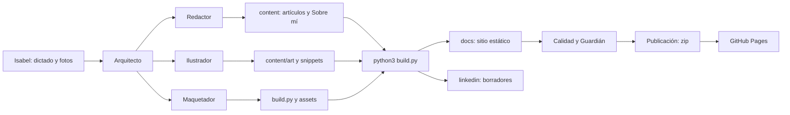

# Arquitectura del Cuaderno

## Objetivo
Un blog personal estático y bilingüe donde Isabel documenta lo que aprende, con un diseño propio y publicación gratuita en GitHub Pages. Sin base de datos, sin panel de administración y sin servicios de terceros.

## Visión general


## Capas
| Capa | Qué contiene | Dónde |
|---|---|---|
| Contenido | Artículos, Sobre mí, componentes y arte | `content/` |
| Presentación | Estilos, scripts, tipografías, favicon | `assets/` |
| Generación | Convierte contenido en sitio | `build.py` |
| Herramientas | Generan diagramas e ilustraciones | `herramientas/` |
| Salida | Sitio publicado | `docs/` (no se edita a mano) |
| Difusión | Borradores de LinkedIn | `linkedin/` |
| Gobierno | Agentes, reglas y planes | `documentacion/` |

## Mapa de carpetas
```
cuaderno/
  site.json              configuración: nombre, LinkedIn, dirección, textos
  build.py               generador del sitio
  BRAND.md               identidad visual y norma de ilustración
  assets/                style.css, main.js, favicon, fonts/
  content/
    es/ y en/            posts/, about.md, snippets/
    art/                 cabeceras en SVG y PNG
  herramientas/          art.py, gen_diagrams.py, render_art.py
  docs/                  SALIDA: lo que publica GitHub Pages
  linkedin/              borradores de publicaciones
  documentacion/         esta carpeta
```
> `docs/` es el sitio ya construido y `documentacion/` es la documentación del proyecto. No se confunden.

## Modelo de contenido
Cada artículo es un archivo Markdown con cabecera YAML.

| Campo | Para qué |
|---|---|
| `id` | Une la versión en español con la inglesa |
| `title`, `summary`, `date`, `tags` | Datos básicos y SEO |
| `accent` | Color de acento del artículo |
| `hero`, `quote` | Cabecera ilustrada y frase para la imagen social |
| `teacher`, `teacher_url` | Crédito de la clase |
| `order`, `draft` | Orden entre artículos del mismo día y borrador |
| `linkedin` | Gancho del borrador de LinkedIn |

Los componentes se insertan con `{{include:nombre}}` y viven en `content/es|en/snippets/`.

## Flujo de generación
1. `build.py` lee `site.json` y `content/`.
2. Convierte Markdown en HTML, incrusta componentes y cabeceras.
3. Genera por idioma: portada, lista de artículos, páginas, RSS, y por artículo la imagen social.
4. Escribe `sitemap.xml`, `robots.txt`, `404.html` y la página raíz que elige el idioma.
5. Copia `assets/` (con las fuentes) y deja los borradores en `linkedin/`.

## Requisitos no funcionales
- **Privacidad:** ninguna petición a terceros; fuentes alojadas en el propio sitio.
- **Accesibilidad:** texto alternativo, contraste, teclado y respeto de `reducir movimiento`.
- **Rendimiento:** sin librerías; SVG ligeros; tipografías de unos 20 a 60 KB cada una.
- **Mantenibilidad:** un solo script de generación y componentes reutilizables.
- **Coste:** cero. GitHub Pages gratuito.

## Riesgos y límites
- El repositorio es público: todo lo que se sube se puede leer. Las reglas del Guardián existen por eso.
- No hay comentarios ni formularios; si se quisieran, habría que añadir un servicio externo.
- Las ilustraciones son vectoriales; no se generan fotografías.

## Cómo extender
- **Nuevo artículo:** crear los dos `.md` con el mismo `id` y seguir la checklist A.
- **Nuevo componente:** snippet HTML, estilos en `style.css` y registrarlo en `herramientas/`.
- **Nuevo idioma:** añadirlo en `site.json`, textos en `build.py` y carpeta en `content/`.
