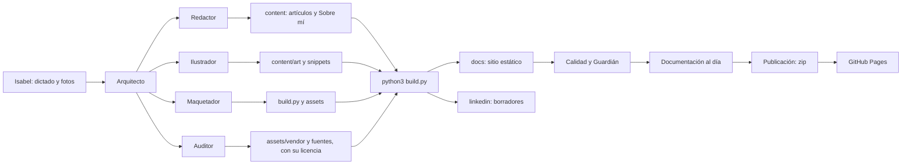

# Arquitectura de Rumbo

## Objetivo
Un blog personal estático y bilingüe donde Isabel documenta lo que aprende, con un diseño propio y publicación gratuita en GitHub Pages. Sin base de datos, sin panel de administración y sin servicios de terceros.

## Visión general


## Capas
| Capa | Qué contiene | Dónde |
|---|---|---|
| Contenido | Artículos, Sobre mí, componentes y arte | `content/` |
| Presentación | Estilos, scripts, tipografías, favicon | `assets/` |
| Dependencias | Librerías y fuentes de terceros, con su licencia | `assets/vendor`, `assets/fonts` |
| Generación | Convierte contenido en sitio | `build.py` |
| Herramientas | Generan diagramas e ilustraciones y revisan proyectos públicos | `herramientas/` |
| Salida | Sitio publicado | `docs/` (no se edita a mano) |
| Difusión | Borradores de LinkedIn | `linkedin/` |
| Gobierno | Agentes, reglas, decisiones, auditorías y registro de cambios | `documentacion/` |

## Mapa de carpetas
```
cuaderno/
  site.json              configuración: nombre, LinkedIn, dirección, textos
  build.py               generador del sitio
  BRAND.md               identidad visual, norma de ilustración y reglas de movimiento
  assets/                style.css, main.js, favicon, fonts/, vendor/
  content/
    es/ y en/            posts/ (entradas), projects/ (proyectos), about.md, snippets/
    art/                 cabeceras en SVG y PNG
  herramientas/          art.py, gen_diagrams.py, render_art.py, auditar.py
  docs/                  SALIDA: lo que publica GitHub Pages
  linkedin/              borradores de publicaciones
  documentacion/         esta carpeta: arquitectura, decisiones, agentes,
                         auditorias/, DEPENDENCIAS.md, CHANGELOG.md, LECCIONES.md
```
> `docs/` es el sitio ya construido y `documentacion/` es la documentación del proyecto. No se confunden.

## Modelo de contenido
Hay dos tipos de página, ambos archivos Markdown con cabecera YAML: las **entradas** (explican una idea) y los **proyectos** (algo que se construye, con su estado, herramientas y resultados).

| Campo | Para qué |
|---|---|
| `id` | Une la versión en español con la inglesa |
| `title`, `summary`, `date`, `tags` | Datos básicos y SEO |
| `accent` | Color de acento del artículo |
| `hero`, `quote` | Cabecera ilustrada y frase para la imagen social |
| `teacher`, `teacher_url` | Crédito de la clase |
| `order`, `draft` | Orden entre artículos del mismo día y borrador |
| `linkedin` | Gancho del borrador de LinkedIn |

Los componentes se insertan con `{{include:nombre}}` y viven en `content/es|en/snippets/`. Una entrada se une a uno o varios proyectos con `projects: [id, ...]`, y desde el texto se enlaza un proyecto con `{{project:id}}`.

### Proyectos
| Campo | Para qué |
|---|---|
| `id`, `title`, `subtitle`, `summary` | Identificación y textos |
| `status` | `en-marcha`, `terminado` o `idea` (se muestra como una etiqueta) |
| `stack` | Herramientas o temas |
| `repo`, `demo` | Enlaces opcionales |
| `date`, `updated` | Inicio y última actualización |
| `hero`, `accent` | Ilustración de cabecera y color de acento |
| `related_title` | Título de la lista de entradas relacionadas (por defecto, «Entradas relacionadas») |
| `linkedin` | Gancho del borrador de LinkedIn |

Direcciones: `/es/proyectos/…` y `/en/projects/…`. La página de un proyecto lista automáticamente las entradas que lo declaran, y cada entrada enlaza de vuelta a sus proyectos.

### Proyectos actuales
- **Formación en Data Science e IA:** agrupa los apuntes de cada clase.
- **Clasificador de reciclaje:** proyecto propio, enlazado con la entrada sobre Machine Learning.

## Flujo de generación
1. `build.py` lee `site.json` y `content/`.
2. Convierte Markdown en HTML, incrusta componentes y cabeceras.
3. Genera por idioma: portada, lista de proyectos y de entradas, páginas, RSS, y por entrada y por proyecto la imagen social.
4. Escribe `sitemap.xml`, `robots.txt`, `404.html` y la página raíz que elige el idioma.
5. Copia `assets/` (con las fuentes y las librerías alojadas) y deja los borradores en `linkedin/`.

## Comportamiento en el navegador
- **Marcas en la etiqueta `html`:** un pequeño script de la cabecera añade `anim` si el navegador admite `IntersectionObserver` y `rm` si el sistema pide reducir movimiento. Sin JavaScript no se añade nada y todo se ve completo.
- **Animaciones** (CSS): aparición de textos al hacer scroll, siete cajitas por partes y brújula orientándose. Con `rm` se convierten en desvanecimientos breves.
- **Orbes vivos en los proyectos «en marcha»:** `assets/main.js` monta el mismo motor de orbes en cada `canvas.orb-live` (dentro de la etiqueta de estado), con el color de acento de cada proyecto. Cada orbe se pausa cuando no se ve y se queda quieto con `reducir movimiento`.
- **Indicador "Pensando…":** `assets/main.js` monta el motor de orbes (`assets/vendor/thinking-orbs.js`) junto al nombre del cuaderno. Solo aparece si cargar o cambiar de página tarda más de 140 ms y se oculta al llegar. Con `?orbs` en la dirección se ve 4 segundos como demostración.
- **Portada:** una montaña con camino y banderas, dibujada por `build.py` (`rumbo_svg`). Cada proyecto publicado es una bandera con enlace y, al pasar el ratón o enfocarla con el teclado, muestra su título; los proyectos que aún no existen aparecen como banderas punteadas. El más antiguo queda abajo y el más reciente arriba (hasta seis). Si cambian los proyectos, la portada cambia sola.

## Dependencias y seguridad
- Todo lo de terceros pasa por el [Auditor](agentes/subagentes/09-auditor.md) y queda en [`DEPENDENCIAS.md`](DEPENDENCIAS.md) con su informe en [`auditorias`](auditorias/README.md).
- Solo se aloja lo que se usa de verdad (por ejemplo, solo el latín de las fuentes y solo el motor de los orbes, sin React).
- Cada pieza lleva su licencia en el propio proyecto.
- La web no hace ninguna petición a otros sitios.

## Requisitos no funcionales
- **Privacidad:** ninguna petición a terceros; fuentes y librerías alojadas en el propio sitio.
- **Accesibilidad:** texto alternativo, contraste, teclado y versión suave para `reducir movimiento`.
- **Rendimiento:** un único script de terceros de 15,5 KB, sin otras librerías; SVG ligeros; tipografías de 20 a 60 KB cada una; animaciones con solo `transform` y `opacity`.
- **Mantenibilidad:** un solo script de generación, componentes reutilizables y documentación al día en cada versión.
- **Coste:** cero. GitHub Pages gratuito.

## Riesgos y límites
- El repositorio es público: todo lo que se sube se puede leer. Las reglas del Guardián existen por eso.
- No hay comentarios ni formularios; si se quisieran, habría que añadir un servicio externo.
- Las ilustraciones son vectoriales; no se generan fotografías.
- La librería de los orbes es un proyecto joven mantenido por una persona; por eso se aloja una copia con la versión fijada.
- La herramienta del Auditor busca señales y da falsos positivos: siempre hay lectura manual.

## Cómo extender
- **Nuevo artículo:** crear los dos `.md` con el mismo `id` y seguir la checklist A.
- **Nuevo componente:** snippet HTML, estilos en `style.css` y generador en `herramientas/`.
- **Nueva dependencia:** pasar por el Auditor antes (checklist F).
- **Nuevo idioma:** añadirlo en `site.json`, textos en `build.py` y carpeta en `content/`.
- **Nueva versión:** actualizar la documentación y generar el zip (checklist C).
